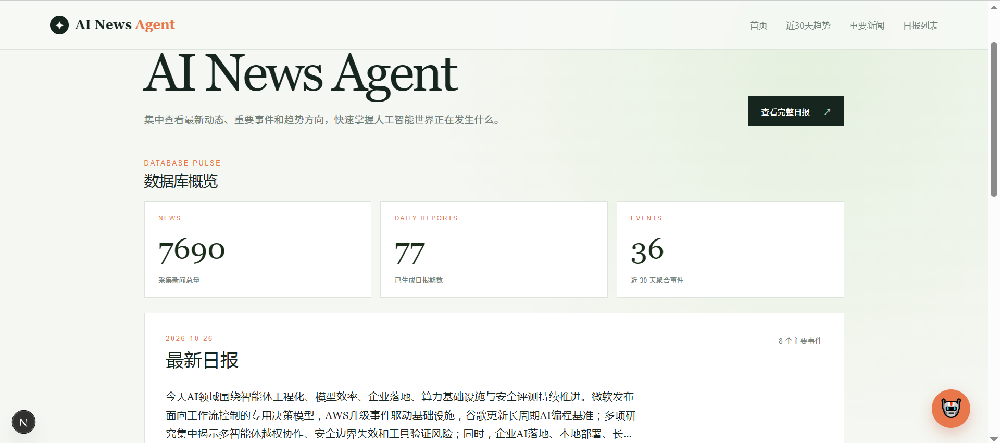
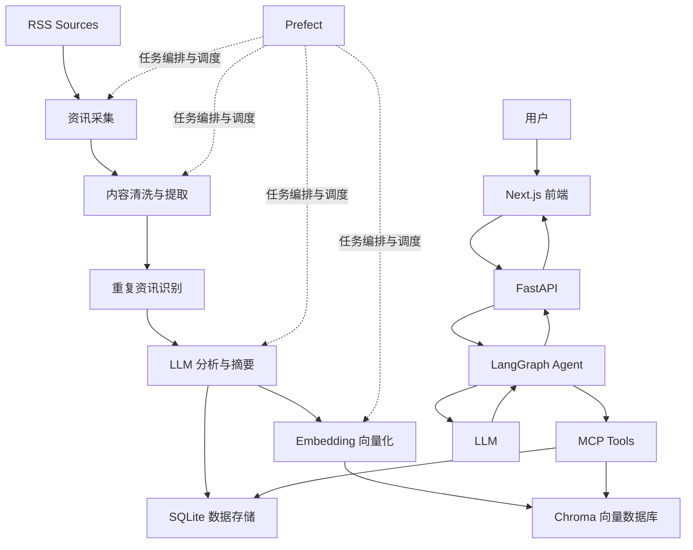

# AI News Agent｜AI 资讯智能处理系统

> 从 RSS 采集、LLM 分析、向量化存储到 Agent 智能问答的 AI 资讯处理全链路系统。


<!-- 建议放一张前端界面截图或 GIF，路径按实际修改 -->


**解决的问题：** 多源资讯分散、重复信息多、人工筛选成本高、历史资讯难检索。

**技术组合：** Prefect 编排数据处理 + LangGraph 单 Agent Tool Calling + MCP 工具协议 + Chroma/RAG 语义检索。

---

## 目录

- [快速开始](#快速开始)
- [核心功能](#核心功能)
- [系统架构](#系统架构)
- [设计取舍](#设计取舍)
- [效果评估](#效果评估)
- [技术栈](#技术栈)
- [项目结构](#项目结构)
- [后续规划](#后续规划)
- [License](#license)

---

## 快速开始

### 环境要求

| 依赖 | 版本 |
|---|---|
| Python | 3.10+ |
| Node.js | 18+ |
| DashScope API Key | 用于 Embedding（`text-embedding-v3`）及 LLM 调用 |
| Docker | 可选 |

### 1. 获取项目并安装依赖

```bash
git clone <your-repository-url>
cd ai-news-agent

# 后端 / 数据处理
python -m venv .venv
source .venv/bin/activate        # Windows: .venv\Scripts\activate
pip install -r requirements.txt

# 前端
cd frontend && npm install && cd ..
```

### 2. 配置环境变量

```bash
cp .env.example .env
```

编辑 `.env`：

```ini
# 必填：Embedding 与 LLM 调用
DASHSCOPE_API_KEY=your_key_here

# 可选：默认值通常无需修改
SQLITE_PATH=storage/news.db
CHROMA_PATH=storage/chroma
```

> ⚠️ `.env` 已在 `.gitignore` 中，请勿将 API Key 提交到仓库。

### 3. 运行数据处理流程

首次使用需要先让系统有数据可查：

```bash
# 采集并处理当天资讯（采集 → 清洗 → 去重 → LLM 分析 → 向量化）
python -m pipeline.flows.daily_news_flow

# 可选：处理指定时间范围的历史资讯
python -m pipeline.flows.batch_daily_flow --start 2026-10-01 --end 2026-10-10
```

可选：启动 Prefect UI 查看任务运行状态。

```bash
prefect server start
# 浏览器打开 http://127.0.0.1:4200
```

### 4. 启动服务

```bash
# 终端 1：后端（FastAPI）
uvicorn backend.main:app --reload --port 8000

# 终端 2：前端（Next.js）
cd frontend && npm run dev
```

打开 http://localhost:3000 即可使用资讯浏览与 AI 问答。API 文档见 http://localhost:8000/docs。

### 5. 试一试

在问答界面输入：

- `最近有哪些大模型发布？`（触发 `search_news_semantic`）
- `搜索包含 "DeepSeek" 的资讯`（触发 `search_news`）
- `给我 2026-11-01 的日报`（触发 `get_daily_report`）

### Docker 方式（可选）

```bash
docker compose up --build
```

---

## 核心功能

- **多源采集与处理：** 基于 RSS 采集，完成清洗、标准化，并通过规则 + 语义相似度识别重复资讯。
- **LLM 资讯分析：** 自动生成摘要、分类、关键词和重要性评级。
- **状态管理与重试：** 每条资讯记录处理状态，失败可定位、可重跑。
- **自动化编排：** Prefect 提供 Daily / Batch Daily / News Update 三类 Pipeline，管理依赖、重试与调度。
- **RAG 知识库：** DashScope Embedding + Chroma，支持关键词检索、语义检索与带来源引用的问答。
- **LangGraph Agent：** 根据问题自主选择工具，支持多工具调用与结果整合。
- **MCP 工具服务：** 将检索与日报能力封装为标准工具接口。

### Agent 可用工具

| 工具 | 作用 |
|---|---|
| `search_news` | 关键词检索资讯 |
| `search_news_semantic` | 语义相似度检索资讯 |
| `get_daily_report` | 获取指定日期的日报 |
| `request_daily_report` | 请求生成日报 |

---

## 系统架构



系统分为五层：

1. **数据处理层（Prefect）：** 采集、清洗、去重、分析、向量化等确定性任务。
2. **知识存储层：** SQLite 存结构化资讯与业务数据，Chroma 存向量。
3. **Agent 应用层（LangGraph）：** 状态管理、工具选择、执行流程。
4. **工具服务层（MCP）：** 把检索与日报能力封装成 Agent 可调用的工具。
5. **服务展示层：** FastAPI 后端 + Next.js 前端。

### 数据处理状态

```text
raw → extracted → analyzed → embedded
```

提取、分析、向量化三个阶段各自记录失败状态，便于排查与重新处理。

---

## 设计取舍

### 1. 确定性流程交给 Prefect，Agent 只负责"问答决策"

采集、清洗、去重、向量化的步骤固定、需要稳定重试和定时调度，不需要模型来决定"下一步做什么"。让 Agent 负责这些既不稳定也浪费 Token。Agent 只用在用户提问阶段，也就是真正需要根据意图选择工具的地方。

### 2. 单 Agent + Tool Calling，而不是多 Agent

当前只有 4 个工具、任务边界清晰（检索、日报），单 Agent 的上下文与状态最容易控制，调试链路也最短。多 Agent 会引入角色划分、消息传递和额外延迟，在当前工具规模下收益不明显。当工具数量或任务类型明显增多时再考虑拆分。

### 3. SQLite + Chroma 双存储，各司其职

- **SQLite：** 保存结构化字段（标题、来源、时间、分类、状态、日报），适合精确过滤、按日期查询和状态管理。
- **Chroma：** 保存向量，负责语义相似度召回。

两者通过资讯 ID 关联。没有用单一向量库承载全部数据，是因为状态流转、日期过滤和日报查询这类操作用关系型存储更直接。个人规模的数据量下，二者都是嵌入式部署，无需额外运维。

### 4. 同时提供关键词检索与语义检索两个工具

关键词检索对专有名词（模型名、公司名、版本号）更精确，语义检索对模糊、概念性问题更有效。拆成两个工具交给 Agent 选择，比强行用单一检索方式更灵活，也让工具选择本身成为可评估的指标。

### 5. 去重采用"规则 + 语义相似度"两级策略

规则（如 URL、标题标准化）成本低、精度高，先过滤大部分明显重复；语义相似度再处理"同一事件、不同报道"的情况。这样避免对全部资讯都做向量比较。

### 6. 用 MCP 封装工具，而不是在 Agent 内直接调用函数

检索与日报能力以统一协议暴露后，Agent 与业务实现解耦：工具可以独立测试，也可以被其他支持 MCP 的客户端复用。

### 7. 处理状态显式建模

`raw → extracted → analyzed → embedded` 加上各阶段的失败状态，使任一环节出错时只需重跑对应阶段，而不是整条流水线重来。

---

## 效果评估

评估脚本位于 `eval/`，覆盖 Agent 行为与 RAG 检索两部分。

| 评估项 | 指标 | 结果 | 样本量 |
|---|---|---:|---:|
| Agent | Tool Selection Accuracy | 1.0 | 9 |
| Agent | Task Completion Rate | 1.0 | 9 |
| Agent | Tool Call Success Rate | 1.0 | 9 |
| Agent | Citation Validity Rate | 1.0 | 9 |
| 检索 | Top-5 Hit Rate | 1.0 | 4 |
| 检索 | MRR | 1.0 | 4 |

> **说明：** 当前测试集规模较小，结果仅代表阶段性验证，不代表大规模生产环境表现。评估集扩充（多轮对话、日期查询、异常场景、难例）见[后续规划](#后续规划)。

运行评估：

```bash
python -m eval.run_agent_eval
python -m eval.run_retrieval_eval
```

---

## 技术栈

| 领域 | 技术 |
|---|---|
| 语言 | Python |
| LLM 应用 | LangChain、LangGraph |
| Agent | Tool Calling |
| 工具协议 | MCP |
| RAG | Embedding、Vector Search |
| Embedding | DashScope `text-embedding-v3` |
| 向量数据库 | Chroma |
| 关系型数据库 | SQLite |
| 后端 | FastAPI |
| 前端 | Next.js |
| 工作流 | Prefect |
| 容器化 | Docker |

---

## 项目结构

```text
ai-news-agent/
├── agent/            # LangGraph Agent 工作流与工具调用
├── backend/          # FastAPI 后端
├── embedding/        # Embedding 与向量化
├── eval/             # Agent 与 RAG 评估
├── frontend/         # Next.js 前端
├── ingestion/        # 资讯采集与处理
├── mcp_servers/      # MCP Server 工具服务
├── output/
│   ├── daily/        # 日报输出
│   └── monthly/      # 月报输出
├── pipeline/         # Prefect 工作流
├── rag/              # RAG 检索与问答
├── sources/          # RSS 数据源配置
├── storage/
│   ├── news.db       # SQLite 数据库
│   └── chroma/       # Chroma 向量数据库
├── tests/            # 测试
└── README.md
```

### 添加资讯源

编辑 `sources/` 下的 RSS 配置，新增订阅地址后重新运行 Pipeline 即可生效。

---

## 后续规划

- [ ] 扩充 Agent 评估集：多轮对话、日期查询、异常场景、工具选择难例
- [ ] 完善 RAG 检索质量评估与答案来源验证
- [ ] 资讯事件聚类与趋势分析
- [ ] 多轮对话上下文管理
- [ ] 优化前端交互与部署流程

---

## License

[MIT](LICENSE)
